# Android native splash — 19 October 2026

Issue [#606](https://github.com/FireBird1998/splitbook/issues/606), PR [#626](https://github.com/FireBird1998/splitbook/pull/626). Implementation: `cf529ea22c88d60760c018a926b6704cdadb304e`. Baseline: `5c70070343af6a49cf817d64a5d1f12a16a4f66f`.

## Result

**Passed:** six fixed-build cold starts, light/dark at 100%, 130% and 200% system text. The native mark remains visible through font startup and hands off to the app without a visible font-loading spinner or blank flash. The sign-in button is enabled, clickable and fully on-screen in every case. Its captured bounds are listed below.

The native splash uses the existing mark on Paper in light mode and Ink in dark mode. Its size stays independent of system text scale. A brief normal “Checking your session…” state is visible in some dark-mode transitions; it remains an app session-loading state, not the removed “Opening Splitbook…” font-loading spinner. No other loading state was changed.

The six baseline recordings are included for comparison. Fonts completed within the native transition on this emulator, so those recordings do **not** clearly expose the old spinner. The failing-first tests, rather than an invented visual difference, reproduce the old loading state deterministically.

## Method and isolation

- Emulator `emulator-5554`, 1080 × 2400; exclusive use after the previous worker released it.
- ARM64 release-mode APKs with embedded bundles, not a development launcher or a live development server. Each case force-stops the app before an explicit activity launch.
- A separate, newly installed QA package, `com.splitbook.app.splash606`, isolates the test from the existing apps and their data. The package-id override exists only in ignored, generated Android build files; it is not a product change.
- Both APKs use the same public staging configuration to reach the real sign-in screen. No Google sign-in was attempted and no member or ledger data was accessed. The original unconfigured comparison APKs were not used for this acceptance pass.
- The before APK uses the baseline App; the after APK uses the committed fix. Tracked source was restored after the comparison builds and remains unchanged.
- Five-second screen recordings and full-resolution final screenshots were captured for all 12 cases. The previews below omit the launcher preamble and run at 15 fps. The linked frame sheets include every captured frame from the full native splash through the first screen transition, with original frame numbers and timestamps. All six fixed transition sheets were visually reviewed; text recognition also found no “Opening” frame in the recorded transition windows.

## Before and after

| Mode / text  | Baseline preview                                                       | Fixed preview                                                      | Fixed final screen                                               | Every captured transition frame                                         |
| ------------ | ---------------------------------------------------------------------- | ------------------------------------------------------------------ | ---------------------------------------------------------------- | ----------------------------------------------------------------------- |
| Light · 100% | 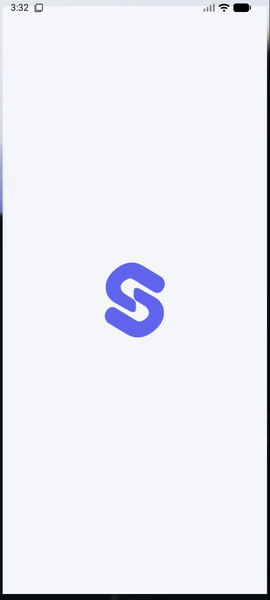 | 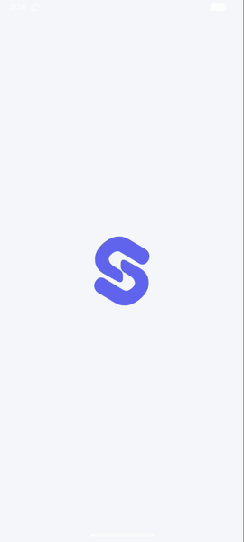 | [Full screenshot](2026-10-19-android-splash/after-light-100.png) | [Frame sheet](2026-10-19-android-splash/after-light-100-transition.png) |
| Light · 130% | 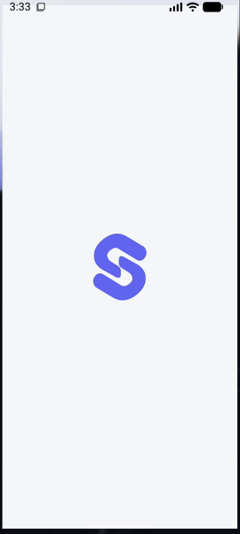 | 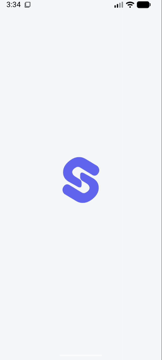 | [Full screenshot](2026-10-19-android-splash/after-light-130.png) | [Frame sheet](2026-10-19-android-splash/after-light-130-transition.png) |
| Light · 200% | 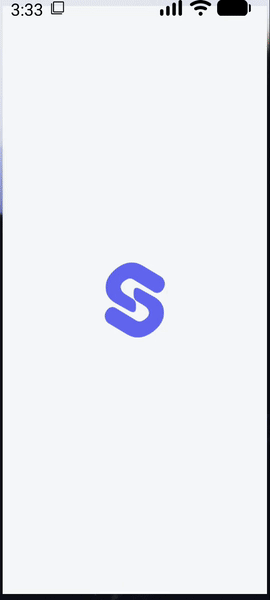 | 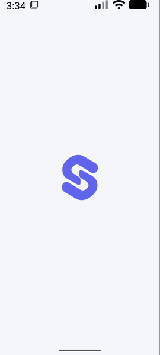 | [Full screenshot](2026-10-19-android-splash/after-light-200.png) | [Frame sheet](2026-10-19-android-splash/after-light-200-transition.png) |
| Dark · 100%  | 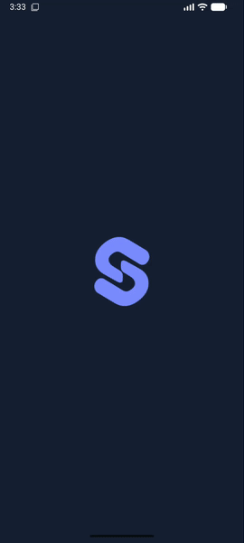   | 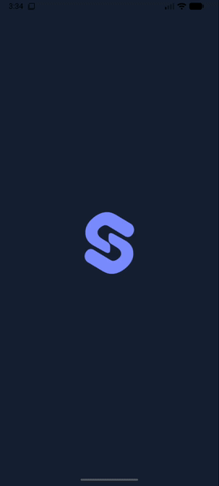   | [Full screenshot](2026-10-19-android-splash/after-dark-100.png)  | [Frame sheet](2026-10-19-android-splash/after-dark-100-transition.png)  |
| Dark · 130%  | 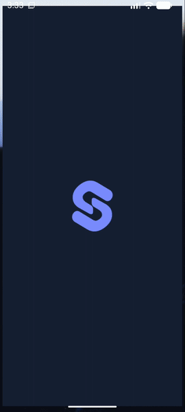   | 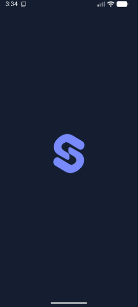   | [Full screenshot](2026-10-19-android-splash/after-dark-130.png)  | [Frame sheet](2026-10-19-android-splash/after-dark-130-transition.png)  |
| Dark · 200%  | 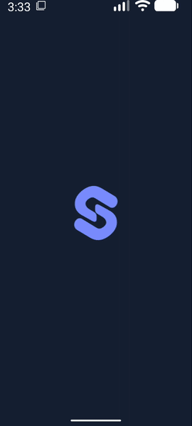   | 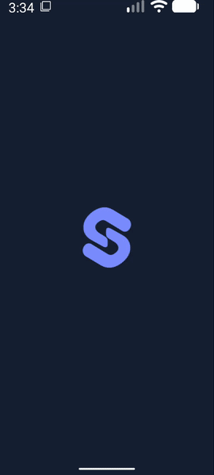   | [Full screenshot](2026-10-19-android-splash/after-dark-200.png)  | [Frame sheet](2026-10-19-android-splash/after-dark-200-transition.png)  |

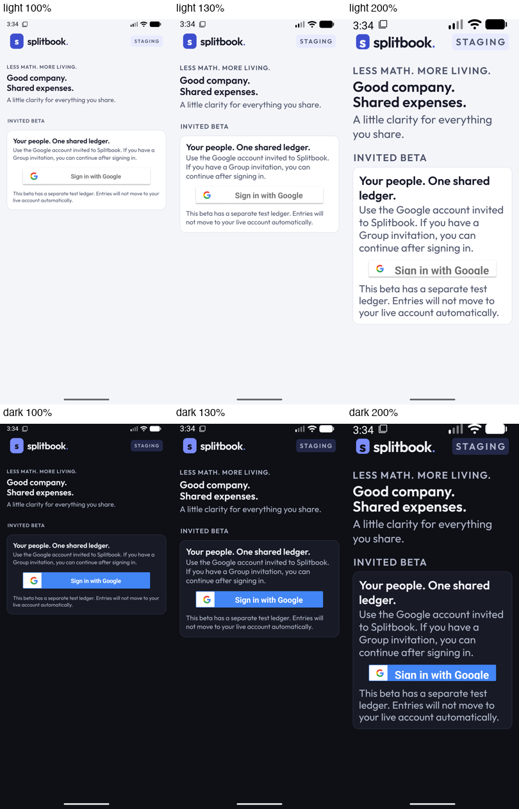

## First usable screen

The native sign-in control was enabled and clickable at these bounds, within the 1080 × 2400 viewport, in both builds and both modes. No sign-in action was invoked.

| System text | Button bounds, physical pixels |
| ----------- | ------------------------------ |
| 100%        | `[81,913][999,1039]`           |
| 130%        | `[81,1031][999,1157]`          |
| 200%        | `[81,1489][999,1615]`          |

## Tests and limits

The three startup cases in `apps/mobile/src/app-states.test.tsx` fail against the baseline App and pass with the fix. They cover retention at module load, no rendered launch UI while fonts load, and hiding the splash after either loaded fonts or a font error. The complete App-state suite passes 86 cases, including existing Group loading behavior.

The full local gate passed on implementation head `cf529ea2`: lint, typecheck, formatting, 5,224 unit tests, ceilings and all 11 backend verifiers. The native comparison APK builds and signature checks passed. This evidence-only follow-up changes no runtime code, so those passed checks were not repeated. Current-head PR checks are verified separately on the PR.

Actual font failure was not injected into the emulator APKs; the approved startup test covers that error path through mocked native font/splash boundaries. These checks establish the startup transition and usable sign-in controls, not a Google authentication journey. Original recordings, hierarchy dumps, matrix results and restoration records remain in `/private/tmp/606-evidence/device/` for local review.

## Device restoration

The QA package was removed after capture. The original development APK's path and SHA-256 match the preserved original. System font scale is restored to `1.0`, night mode to `no` (light), and the original empty reversal list is unchanged. No existing app data was cleared, no existing APK was replaced, and no shared backend or emulator reversal was used. Emulator 5554 is released. No deployment or merge was performed.
